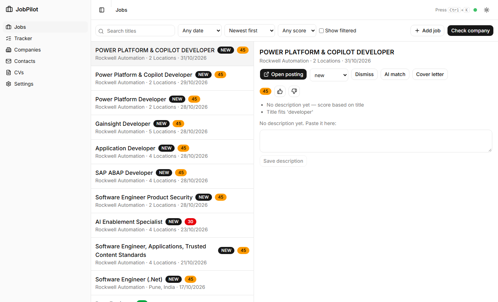
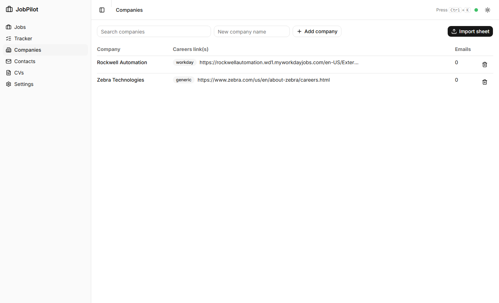
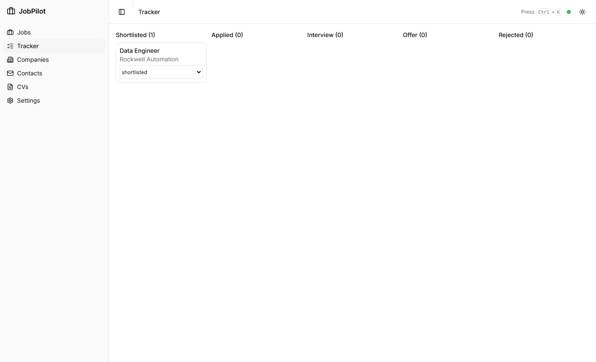

# JobPilot

A personal, local job-search assistant. Check one company at a time, pull its latest jobs
straight from its careers site, rank them against your CV with reasons, and keep track of where
you applied. Everything runs on your own machine.



## What it does

- **Company directory**: import your sheet (`Company | Website | Hr contacts`); careers links are
  recognised by platform (Workday, Oracle, SmartRecruiters, Ashby, Greenhouse, Lever, iCIMS, or
  generic).
- **Check a company**: by name from your list, or by pasting a careers link. An unknown company
  triggers a careers-page search and you pick the right result.
- **Readers**: platform JSON readers first. Any other careers page is opened in a real browser
  (Playwright) and read by an LLM.
- **Ranking**: each job gets a 0–100 score with reasons from your CV skills and title fit.
  Senior roles, off-topic titles, wrong locations and jobs that ask for too much experience are
  filtered (and can be shown with one toggle). 👍/👎 teaches it; "hide similar" removes a title
  family. An optional **AI match** asks a local Qwen model to judge a single job.
- **Tracker**: shortlist → applied → interview → offer / rejected.
- **Contacts**: an email list you can add to and delete from, with an **email finder** that guesses
  addresses from the company's known pattern. Guesses are never verified or sent.
- **Cover letter draft** per job, written only from facts in your CV.

| Companies | Tracker |
|---|---|
|  |  |

## Stack

| Layer | Tech |
|---|---|
| Backend | FastAPI, SQLAlchemy 2, Alembic, Postgres 17, pydantic 2, dynaconf, LiteLLM, Playwright |
| Frontend | React 19, Vite, TypeScript, Tailwind, shadcn/ui, TanStack Query |
| Models | Groq (`openai/gpt-oss-120b`) and local Qwen 3 4B via Ollama; switchable in Settings |
| Tooling | uv, ruff, mypy (strict), pytest, vitest |

## Run it

Prerequisites: Python 3.12, [uv](https://docs.astral.sh/uv/), Node 20+, Postgres 17, and
(optionally) [Ollama](https://ollama.com) with `qwen3:4b`.

```bash
# 1. Database
createdb jobpilot && createdb jobpilot_test

# 2. Backend
cd jobpilot-backend
cp .env.example .env          # fill in DATABASE_URL, TEST_DATABASE_URL, GROQ_API_KEY, ...
uv sync
uv run playwright install chromium
uv run alembic upgrade head
uv run python main.py          # http://127.0.0.1:8000

# 3. Frontend
cd ../jobpilot-frontend
npm install
npm run dev                    # http://localhost:5173
```

Then open Companies → **Import sheet**, and Jobs → **Check company**.

### Tests and checks

```bash
cd jobpilot-backend && uv run pytest -q && uv run ruff check src tests && uv run mypy src
cd jobpilot-frontend && npm run test && npx tsc -b && npm run build
```

Database tests need `TEST_DATABASE_URL` pointing at a database whose name ends in `_test`
(the test bootstrap refuses anything else so the dev data can't be wiped).

## Layout

```
jobpilot-backend/    FastAPI app (src/api, directory, discovery, matching, llm, search)
jobpilot-frontend/   React app (views, components, api client)
docs/                decision doc, phased plans, screenshots
scripts/             PowerShell helpers (dev.ps1, check.ps1; need PowerShell 7)
```

## Security notes

- The API binds to `127.0.0.1`, enforces trusted hosts and CORS, and requires an
  `X-JobPilot: 1` header on every mutating request (blocks cross-site form posts).
- Only `http(s)` URLs are stored or rendered. Page text sent to an LLM is treated as data.
- Secrets live in `jobpilot-backend/.env`, which is git-ignored. Never commit it.

## Status

Built: directory, discovery (Workday verified live), scoring, feedback, tracker, contacts and
email finder, model settings. Not built yet: CV tailoring with PDF output (needs MiKTeX),
embedding-based semantic scoring. Readers other than Workday are untested against live sites.
